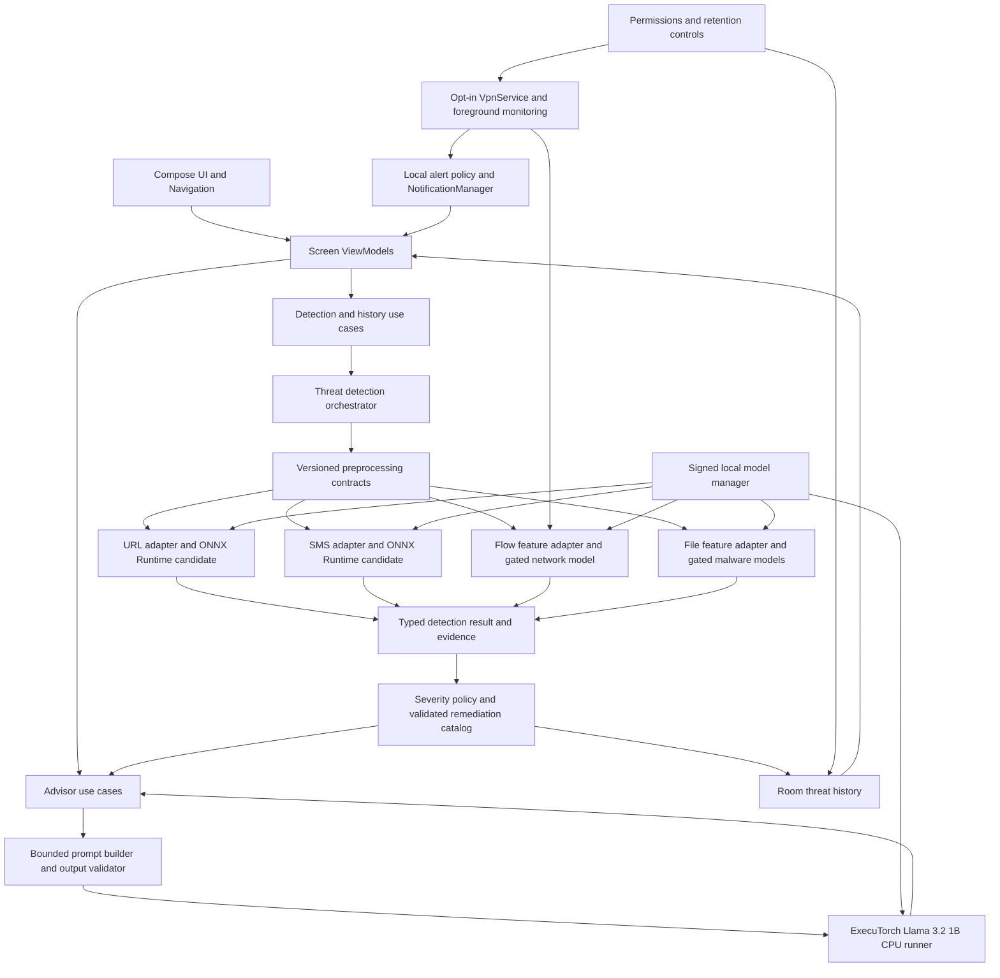

# On-Device AI Cybersecurity Assistant — System Architecture

**Status:** Planning proposal, 7 November 2026. No Android implementation or model conversion has been performed. See `IMPLEMENTATION_PLAN.md` for the repository audit, readiness gates, and work phases.

## 1. Architecture decisions and operating envelope

- Native Kotlin, Jetpack Compose, Material 3, single activity, Navigation Compose, MVVM presentation, Clean Architecture boundaries, Coroutines/Flow, Hilt, and Room.
- `arm64-v8a` is the production ABI. Proposed `minSdk 28`, `compileSdk 36`, `targetSdk 36`; verify the exact pinned ExecuTorch and ONNX Runtime Android AAR requirements before freezing `minSdk`. Android 16 / API 36 is the current Google Play target for new phone apps and updates [Android target API requirements](https://developer.android.com/google/play/requirements/target-sdk).
- Offline inference is a hard invariant. No runtime cloud APIs, analytics SDK, or telemetry. A manual-scan build needs no `INTERNET` permission. A later VPN-enabled build may need `INTERNET` solely to forward the user's existing traffic through local sockets; that permission must be disclosed and verified to make no app-originated cloud calls. Development machines may access model sources and dependencies. Detection and advice must work with airplane mode enabled once the signed model pack is present.
- A detection is a prediction about a specific supported input representation. The app never claims whole-device protection. Disabled or unavailable detectors appear as **Unavailable**, not **Safe**.
- User initiated URL and pasted/shared SMS analysis is the initial scope. VPN network observation and file malware analysis are gated by feasibility and model-parity results.
- The Llama advisor is optional for *detection*, mandatory for the specified conversational advisor feature. Deterministic safety text remains available if Llama is not provisioned or fails.

## 2. Component diagram

### Communication rules

`ViewModel` calls suspend use cases and exposes immutable `StateFlow<ScreenState>`. A scan use case validates input, calls exactly one detector adapter, normalizes its output, applies a versioned severity/remediation policy, and saves a minimized event. The advisor accepts only a typed `ThreatFinding`, never a raw model response or database row as instructions. Room DAOs expose Flow for dashboard/history. The optional VPN service emits bounded flow summaries through a repository/channel to the orchestrator; it cannot talk directly to Compose. Alerts are deduplicated after policy assessment. Hilt binds interfaces to model/runtime adapters. Each adapter has independent loading, timeout, and error states.

## 3. Domain contracts

`ScanRequest` is one of `UrlText`, `SmsText`, `ObservedFlow`, `SelectedPeFile`, or `SelectedImage`. It includes source, timestamp, request ID, and a strict size bound. `ThreatFinding` contains `scanType`, `modelId`, `modelVersion`, `preprocessorVersion`, `inputRepresentation`, `predictedLabel`, optional `rawScore`, optional **calibrated** risk, `indicators[]`, `severity`, `limitations[]`, and remediation IDs. A probability-like classifier score is displayed as a score only after calibration and out-of-distribution tests; otherwise the UI uses a categorical result plus uncertainty language. Severity comes from explicit rules and evidence, never directly from Llama. The dashboard shows category summaries and latest findings; no universal security score is proposed.

Each `InferenceAdapter` must declare exact feature order, dtype, shape, vocabulary/schema hash, label map, missing-value rule, preprocessing version, runtime version, and model SHA-256 in a manifest. A mismatch fails closed with a clear **Model unavailable** state. Python `.pkl` files are trusted build inputs only, never loaded on Android. They can execute code when unpickled and have scikit-learn version compatibility risk.

## 4. Inference boundaries

| Adapter | Proposed runtime | Contract and gate |
|---|---|---|
| Phishing URL | ONNX Runtime Android CPU for the existing logistic regression or MultinomialNB candidate | Kotlin/Pure JVM reproduction of NLTK `[A-Za-z]+`, English Snowball stemming, joining, and exact CountVectorizer vocabulary/index and tokenization. Output `bad`/`good`. The 448,098-feature sparse input and dense tensor memory must be benchmarked; a compact deterministic linear/Naive Bayes evaluator using exported weights is an alternative only if it preserves the original model numerically. |
| SMS | ONNX Runtime Android CPU for the existing voting classifier only after a portable export is proven | Exact NLTK word tokenization, Unicode `isalnum`, English stopwords, Porter stemming, 3,000-term TF-IDF and 3,001st raw character-count feature. **Missing saved MinMaxScaler blocks faithful deployment.** The three tree/Naive Bayes estimators and ONNX operators require inspection and device tests. |
| DDoS | ONNX Runtime Android for a future export of the existing RF, subject to artifact creation | Ordered 78 CICFlowMeter-style numeric features per bidirectional flow; `BENIGN=0`, `DDoS=1`; data cleaning and NaN/Inf policy frozen. No trained artifact exists. The Android collector must reproduce every required feature before enabling it. |
| PE tabular malware | ONNX Runtime Android for a future export of the existing RF, subject to artifact creation | Ordered 54 numeric Windows PE-header/resource/import features; `legitimate=1`, `malware=0`. No saved fitted RF, logistic model, or Keras weights. A parser must match source feature definitions without executing the selected file. |
| Malware image CNN | ExecuTorch XNNPACK CPU candidate | Existing local `.pt` state dict from `train_cnn.py`; `[1,1,64,64]` float32 grayscale pixels divided by 255; output `[1,2]` logits in `[benign, malware]` order. Export and operator validation are untested. The binary-to-image conversion that produced the dataset is undocumented, so this scanner remains unavailable for arbitrary files. User-selected matching images may be supported after provenance validation. |
| Llama advisor | **ExecuTorch XNNPACK CPU required** | Llama 3.2 1B Instruct, quantized `.pte`, matching tokenizer and chat template; generation is bounded and asynchronous. Never executes a remediation action. |

Runtime choice is based on provenance: ONNX Runtime supports Android Java/Kotlin and CPU execution providers for converted traditional models [ORT mobile](https://onnxruntime.ai/docs/tutorials/mobile/); ExecuTorch has Kotlin/Java Android bindings and an XNNPACK CPU backend [ExecuTorch Android](https://docs.pytorch.org/executorch/stable/using-executorch-android.html). LiteRT is a candidate **only** if a real TensorFlow/Keras artifact becomes available and its conversion succeeds. No current Keras model is saved. Converter/operator compatibility, numerical parity, and ARM performance remain unverified.

## 5. Llama advisory boundary

Recommend **Llama 3.2 1B Instruct** as the initial Arm CPU candidate because ExecuTorch documents a Llama 3.2 1B XNNPACK export path and Android LLM runner. Use the matched tokenizer asset and model-specific chat template and special tokens. Follow ExecuTorch's version-pinned `export_llm` flow, testing a 4-bit-weight / 8-bit-dynamic-activation (`8da4w`) candidate and KV cache; measure quality before selecting quantization. The Android AAR provides `LlmModule` APIs from Kotlin, so a custom Kotlin-to-C++ bridge is **not** initially required; add JNI only if pinned APIs cannot meet streaming/cancellation needs. The current Java/Kotlin LLM APIs are marked experimental [ExecuTorch LLM Android](https://docs.pytorch.org/executorch/stable/llm/run-on-android.html), [LLM export](https://docs.pytorch.org/executorch/stable/llm/export-llm.html). Model acquisition and redistribution must follow the [Meta Llama model license/access terms](https://huggingface.co/meta-llama/Llama-3.2-1B-Instruct).

The model pack is delivered by an explicit offline install path: signed asset pack or a user-imported `.pte` plus tokenizer through the system picker, copied to app-private storage and verified against a signed manifest and hashes. A store delivery mechanism may be considered only if it supports the required fully offline installation path. The app makes no implicit download. If the pack is absent, scans and rule guidance remain operational; chat displays a model-install state. Versioned packs are atomic and rollback-capable.

Example internal prompt contract (conceptual, not executable code): system instructions require JSON fields `summary`, `whySuspicious`, `possibleConsequences`, `safeActions`, `uncertainty`, and `evidenceIds`. The developer payload contains only validated `ThreatFinding` fields and a whitelisted remediation catalog. Raw SMS/URL/filename snippets are escaped, length-limited, and delimited as untrusted evidence; they are never concatenated into role instructions. Reject unknown evidence IDs or actions, validate JSON schema, run a deterministic grounding check, and fall back to rule text on any failure. The advisor says “may be suspicious” where appropriate and never invents evidence. No autonomous deletion, blocking, messaging, or configuration changes.

## 6. Platform monitoring and file scope

### Network

`VpnService` requires user consent and supplies a virtual interface whose packets the app must read **and forward correctly**. A local VPN needs a userspace TCP/IP forwarding path or another proven tunnel implementation; inspecting packets without forwarding would break connectivity. This may require `INTERNET` permission for forwarded sockets, even though model inference and advice remain offline. It does not confer root or unrestricted device packet capture. A local VPN can observe routed traffic metadata and form flow summaries, but encrypted TLS payloads and traffic bypassing the VPN are not inspectable. The existing DDoS model expects 78 flow statistics; the plan must prove mapping, directionality, timing, resets, and timeouts against a reference feature extractor. Until then show passive metadata and **model unavailable**, without a DDoS verdict. Use an opt-in persistent VPN service with a visible foreground notification, explicit pause/stop, revocation handling, battery budget, and a compatible Android 14+ foreground service type reviewed for its actual use. Never imply simultaneous compatibility with another VPN. [VpnService](https://developer.android.com/reference/android/net/VpnService), [foreground service types](https://developer.android.com/develop/background-work/services/fgs/service-types).

### Malware

The 54-feature tabular model analyzes **Windows PE file metadata**, not Android APK behavior. The CNN analyzes pre-generated grayscale malware/benign images, not raw binaries or Android behavior. A user-selected `.exe`/`.dll` PE file through `ACTION_OPEN_DOCUMENT` is the possible tabular workflow once parser parity and artifact export pass. A user-selected PNG matching the CNN representation is the only immediate CNN input, and should be described as research/demo classification until provenance is verified. No automatic whole-device malware scan, installed-app census, root access, unrestricted file access, or real-time behavior claim. File parsing runs in a bounded worker with size/time limits, MIME/content checks, and no execution. The Storage Access Framework supports user-selected files without broad storage permission [Android file picker](https://developer.android.com/training/data-storage/shared/documents-files).

## 7. Storage and privacy

Room tables: `ScanEvent(id, type, createdAt, resultLabel, severity, modelId, modelVersion, preprocessingVersion, scoreKind, scoreValue?, indicatorCodes, status)`, `UserAction(id, scanId, actionCode, timestamp)`, `ModelManifest(id, version, hash, installState, size)`, `MonitoringSession(id, start, end, state, aggregateCounts)`, and `RetentionPolicy(days, saveIndicators, saveConversation)`. Scan history does not store raw SMS, complete URLs, packet payloads, or file bytes by default; a consented local detail option must show its exact retention. Normalize/strip URL query and credentials before any indicator is saved. Room migrations and deletion tests are required. Disable cloud backup for sensitive local data or explicitly exclude it. Use Android Keystore for any encryption keys or sensitive settings, with key-loss recovery semantics; do not claim Keystore encrypts Room by itself. Restrict model and database files to app-private storage. No hidden network requests.

Manual text/URL/share scans need no SMS permission. No `READ_SMS`/`RECEIVE_SMS` in the initial app: Google Play restricts these to eligible default handlers and approved exceptions [Play SMS policy](https://support.google.com/googleplay/android-developer/answer/16558241). Notifications request `POST_NOTIFICATIONS` on Android 13+ only when the feature is enabled [Android notifications](https://developer.android.com/develop/ui/compose/notifications/notification-permission). The VPN consent is separate; its forwarding implementation may need `INTERNET` permission in a VPN-enabled build, with an explicit no-telemetry network audit. No `QUERY_ALL_PACKAGES` or broad storage permission. The app must explain all denied states and provide working manual alternatives.

## 8. UI, navigation, and state

Navigation Compose graph: `Splash/Initialization → Onboarding → Home`, with `Permission Setup` shown contextually. Home has top-level destinations **Dashboard**, **Scan**, **History**, **Advisor**, **Settings**. `Scan` routes to URL, SMS, Network, and Malware screens; result cards route to Threat Details. Settings routes to Model Management/Offline AI Status and retention controls. Each screen ViewModel owns `Idle | Loading | Ready | Error | PermissionDenied | ModelMissing` state. Long inference and model installation expose cancellable progress and never block the main thread.

| Screen | Main component hierarchy and responsibility |
|---|---|
| Splash / Initialization | Branding, local integrity/load checks, clear unavailable-model state. |
| Onboarding | Capability limits, offline operation, privacy choices; no unconditional permission prompts. |
| Permission Setup | Contextual VPN/notification requests, rationale, denied/permanently denied routes. |
| Home Dashboard | Monitoring status, latest events, category cards, quick scans, offline badge; no universal score. |
| URL Scanner | Text field, paste/share entry, Analyze, result, safe actions; never loads URL. |
| SMS Scanner | Paste/share text, Analyze, result; no SMS inbox read. |
| Network Monitor | Opt-in VPN state, flow counts, pause/stop, battery notice, detector readiness. |
| Malware Scanner | SAF file picker, supported file type explanation, progress, unavailable states. |
| Threat Details | Evidence IDs, model/version, limits, safe remediation, optional advisor explanation. |
| AI Security Advisor | Chat around selected result, grounding notice, local model status, cancel generation. |
| Threat History | Filterable events, deletion, empty state, retention setting. |
| Settings | Privacy, notifications, monitoring, retention, accessibility and disclosure. |
| Model Management | Installed pack checksums, versions, storage, import/rollback, offline status. |

Material 3 dark color roles, high contrast text, icons plus labels for risk, scalable typography, TalkBack semantics, reduced-motion support, subtle loading transitions, and no guaranteed-protection messaging.

## 9. Performance and verification contract

**Design budgets, not measurements:** manual URL/SMS classification p95 ≤ 500 ms after warmup; CNN image p95 ≤ 2 s; app cold start to usable dashboard p95 ≤ 3 s without loading Llama; advisor first token target ≤ 10 s and ≥ 3 tokens/s on a chosen reference midrange Arm phone; peak process PSS target ≤ 2.5 GiB while Llama runs; sustained VPN monitoring target ≤ 5% extra battery over an 8-hour matched idle baseline. Provisioned Llama 1B 4-bit weights have a **theoretical** 0.5 GB minimum for weights, with extra tensors, tokenizer, KV cache, runtime, and filesystem overhead; reserve roughly 0.8–1.5 GB **as an initial planning range**, measured before release. Define a 6 GB RAM reference device and lower-memory exclusion/fallback policy after measurement. AAB/APK and model pack sizes remain measured deliverables; separate app binary from the Llama asset.

Benchmark on at least two physical arm64 phones (midrange 6 GB and higher-end 8 GB+), three runs per state, 30+ warm inferences, cold/warm launches, thermal and battery conditions recorded. Measure per-model p50/p95 latency, peak PSS, CPU, energy, storage, generation first-token/tokens per second, VPN overhead, and notification rate. A fixed Python golden corpus is compared with Android outputs (exact tokens/features; float tolerances defined per model; identical labels except documented numerical edge cases). Test airplane mode, denied permissions, model tamper, malformed inputs, process death, and data deletion. No conversion or on-device benchmark has yet been run.
